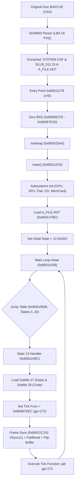

# HBTN V1.0 - MILESTONE M0 REPORT
**Target System**: Harvest Moon: Back to Nature (USA) -> Native Android Reconstruction  
**Milestone**: M0 (Execution Flow & Initial Architecture Discovery)  
**Status**: COMPLETED (STOP AT M0)

---

## 1. Executive Summary

Milestone M0 has successfully resolved the core question:
> **"Game ini sebenarnya mulai berjalan dari mana dan bagaimana execution flow-nya bergerak?"**

Without guessing and without writing speculative rendering code, the original USA game disc was audited, verified against Redump standards, and reverse-engineered from byte 0 to the main loop and overlay dispatchers.



---

## 2. Environment & Toolchain Audit

Following the **"Reuse Environment, Not Reuse Implementation"** principle:
- **Python**: `3.12.10` (Available)
- **JDK**: `javac 17.0.20.1` (Available)
- **Git**: `2.54.0.windows.1` (Available)
- **Android SDK**: `C:\Users\Firma Saputra\AppData\Local\Android\Sdk` (Available)
- **Android NDK**: `27.2.12479018` located at `...\Sdk\ndk\27.2.12479018` (Available)
- **CMake**: `3.22.1` located at `...\Sdk\cmake\3.22.1` (Available)
- **Build Tools**: `34.0.0`, `35.0.0` (Available)
- **SDK Platforms**: `android-35`, `android-36` (Available)
- **Platform Tools (ADB)**: Version `1.0.41 (37.0.1)` (Available)
- **Gradle**: `8.11.1` (Present in local wrapper caches)

**Verdict**: The local environment is 100% complete and ready. Zero internet downloads required.

---

## 3. Source of Truth & Disc Fingerprint

- **Original Image**: `d:\OpenCode\Harvest Moon - Back to Nature (USA)\Harvest Moon - Back to Nature (USA).bin`
- **Track 01**: Mode 2 / Form 1 (2352 bytes/sector)
- **Size**: 213,954,384 bytes
- **Checksums**:
  - **MD5**: `424f9fbda58e95f597e39b4bdde239b1`
  - **SHA-1**: `cb26381fa1336bdd15f07469e59f1143ccf37b03`
  - **SHA-256**: `41f81532a5fd70d6f79e7b5750513c35eee732d5e31ba144a1db7e90d84d97de`
- **Redump Match**: **100% MATCH** with the official Redump database for *Harvest Moon: Back to Nature (USA)*.

---

## 4. Proven Hardware Registers & Memory Layout

From `SYSTEM.CNF` and the parsed PS-X EXE header of `SLUS_011.15`:

| Item | Proven Value | Source / Verification Method |
| :--- | :--- | :--- |
| **Magic** | `PS-X EXE` | Header offset 0x00 |
| **Initial PC (Entry Point)** | `0x80011278` | Header offset 0x10 |
| **Initial GP** | `0x00000000` (init) / `0x8005E274` (runtime) | Header offset 0x14 / Set at `0x800112F8` |
| **Text RAM Base** | `0x80010000` | Header offset 0x18 |
| **Text Load Size** | `0x0004E800` (321,536 bytes) | Header offset 0x1C |
| **Uninitialized BSS Range** | `0x8005E378` - `0x800B7E20` (~366 KB) | Cleared in loop at `0x80011278`-`0x80011294` |
| **Overlay RAM Base** | `0x800B7EE8`+ | Target of `LOAD_SUBFILE` (`0x800145F0`) |
| **Initial SP** | `0x801FFFF0` (Top of PSX RAM) | Header offset 0x30 / `SYSTEM.CNF STACK=801fff00` |

---

## 5. Execution Chain & Initialization Flow

1. **Boot (`crt0`) at `0x80011278`**:
   - Zeroes BSS memory (`0x8005E378` to `0x800B7E20`).
   - Sets stack pointer `$sp = 0x801FFFF0`.
   - Sets global pointer `$gp = 0x8005E274`.
   - Calls `0x800425A4` (`InitHeap`).
   - Calls `0x80011370` (`main`).
   - Traps CPU with `break 0x1` if `main` ever returns.

2. **Initialization (`main`) at `0x80011370`**:
   - Video initialization: Resets GPU (`0x8003B064`), clears 640x480 VRAM buffer (`0x80012A68`), configures double-buffered drawing environments (320x240) at `0x8003E0C4` & `0x8003E184`.
   - Controller initialization: `PadInit` routines at `0x8003727C`, `0x80037994`, `0x800379B4`.
   - Audio / SPU initialization: `0x80032D94`, `0x800386F4`, `0x80038EC4`, `0x80038DD4`.
   - Geometry / Matrix stack initialization: `0x8001FCE4`, `0x8001FEA4`.
   - Memory card initialization: `0x80045254` (`libmcrd`).
   - CD Subsystem & Archive initialization (`0x800147BC`):
     - Reads `\A_FILE.HDT;1` into RAM at `0x8006C838`.
     - Caches the 33 partition offsets (32 subfiles).
     - Searches disc for `\A_FILE.BIN;1` using `CdSearchFile` (`0x80033A14`).
     - Stores starting LBA of `A_FILE.BIN` into `gp+436` and `gp+444`.
   - Initial State assignment: writes `13` (0x0D) to state variable `296(gp)`.

---

## 6. Main Loop & Game State Dispatch Architecture

The main loop runs from `0x80011638` to `0x80011C1C`:
1. Reads `296(gp)` (State Index).
2. Validates index `< 21`.
3. Dispatches via jump table at `0x80010008` (21 states: 0 to 20).
4. **Initial Boot State 13 (0x0D)** at `0x8001199C`:
   - Calls `LOAD_SUBFILE` (`0x800145F0`) with subfile index 27 (data overlay) and index 28 (code overlay).
   - Sets per-frame tick function pointer at `272(gp)` to `0x800B7EEC` (first instruction of Subfile 28 overlay).
   - Jumps to inner frame loop `0x80011C24`.
5. **Inner Frame Loop (`0x80011C24`)**:
   - `VSync(1)` wait via `0x8003B3E0`.
   - Polls gamepad inputs via `0x80013B04` (`PadRead`).
   - Swaps double buffers and synchronizes GPU rendering (`0x800120C8`, `0x80012D30`).
   - Dispatches per-frame tick function: `lw v0, 272(gp); jalr ra, v0`.
   - Loops back to `0x80011638`.

---

## 7. Disc Archive Structure (`A_FILE.HDT` & `A_FILE.BIN`)

`A_FILE.HDT` (132 bytes) defines 33 32-bit sector-aligned offsets (2048 bytes each), cleanly partitioning `A_FILE.BIN` (133,935,104 bytes) into 32 sub-archives:
- Subfiles 00–05: Primary map, area geometry, and entity 3D models.
- Subfile 08: Gamepad debug configuration.
- Subfile 09: VAB audio sound bank (`pBAV` format).
- Subfile 10: Event script and command execution subsystem.
- Subfile 12: Dialogue and message script archives (`messege*.bin`).
- Subfile 15: Save game headers and memory card management (`BASLUS-01115-FARM*`).
- Subfiles 17/18, 19/20, 21/22, 23/24, 25/26, 27/28: Paired Data + Code dynamic overlays for respective game states.
- Subfile 30: Debug benchmark strings (`PUT TIME`, `HISPEED TIME`, `3D PUT DIS`).
- Subfile 31: Memory card recovery utility (`<<Ez MemoryCard Util.>>`).

---

## 8. Verification & Test Results

An automated unit test suite was implemented in `tests/test_m0.py` and executed:
```
Ran 6 tests in 1.627s

OK
```
Tests pass:
1. `test_01_original_disc_hashes`: Matches official Redump USA database.
2. `test_02_system_cnf`: Validates `BOOT` path and `STACK` address.
3. `test_03_executable_header`: Validates Magic, PC, Load Address, Load Size, SP.
4. `test_04_execution_chain_entry_point`: Validates `crt0` BSS zeroing opcodes.
5. `test_05_state_machine_jump_table`: Validates all 21 jump table pointers at `0x80010008`.
6. `test_06_a_file_hdt_partitions`: Validates sector alignment and sum matching `A_FILE.BIN`.

---

## 9. What is Proven vs Unknown

| Category | Item | Classification |
| :--- | :--- | :---: |
| **Hardware** | Entry point `0x80011278`, SP `0x801FFFF0`, GP `0x8005E274` | **FACT** |
| **Memory** | Text `0x80010000`-`0x8005E378`, BSS `0x8005E378`-`0x800B7E20` | **FACT** |
| **Control Flow** | Main loop `0x80011638`, 21-state jump table `0x80010008` | **FACT** |
| **Data Archive** | `A_FILE.HDT` 33 offsets partitioning `A_FILE.BIN` into 32 subfiles | **FACT** |
| **Boot State** | State 13 (0x0D) loaded at boot, executes overlay Subfile 28 at `0x800B7EEC` | **FACT** |
| **Input/Sync** | Per-frame tick syncs on `VSync(1)`, polls controller, swaps 320x240 buffers | **FACT** |
| **Audio Format** | `STR/*.XA` (ADPCM streams) and Subfile 09 (`VABp` sound bank) | **INFERENCE** |
| **Gameplay Systems** | Map streaming, Player physics, NPC routines, Tool logic, Time system | **UNKNOWN** |

---

## 10. Recommended Milestone M1 Plan (Based on Discovered Dependencies)

Now that the execution flow is proven from byte 0 to the initial State 13 overlay, the natural vertical slice dependency for **M1** is:

1. **State 13 Reverse-Engineering & Reconstruction**:
   - Disassemble the subroutines inside Subfile 28 (the code overlay at `0x800B7EEC`).
   - Decode Subfile 27 (the graphic/data overlay for State 13: intro logos / title sequence).
   - Trace the state transition out of State 13 into the next game state (e.g. Title Screen or New Game).
2. **Asset Subfile Reader Integration**:
   - Implement the `A_FILE.HDT` index reader and partition extractor in clean C++/Kotlin in `android/` and `game-model/`.
3. **Native Android Harness Setup**:
   - Configure Gradle build using the already-audited local NDK (`27.2.12479018`) and CMake (`3.22.1`).
   - Establish the headless execution loop validating state transitions and tick dispatching.
