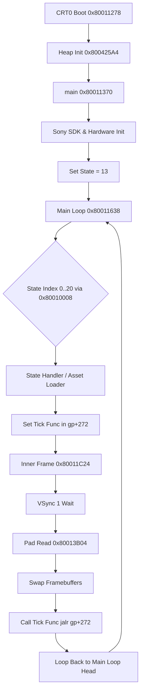

# HBTN V1.0 - GAME MODEL ARCHITECTURE
# Milestone: M0 (Core State Model & Hardware Registers)

## Overview
This directory defines the abstract game model reconstructed from the original USA executable (`SLUS_011.15`) and data files (`A_FILE.BIN` / `A_FILE.HDT`).

## Proven Memory Layout (FACT)

| Memory Region | Virtual Address Range | Size | Description |
| :--- | :--- | :--- | :--- |
| **RAM Text (Executable Code)** | `0x80010000` - `0x8005E378` | ~313 KB | Loaded from file offset 0x800 of `SLUS_011.15` |
| **Global Data / Small BSS** | `0x8005E274` (GP anchor) | N/A | Register `$gp` points to `0x8005E274` |
| **Uninitialized BSS** | `0x8005E378` - `0x800B7E20` | ~366 KB | Zeroed during crt0 startup loop |
| **Overlay RAM Region** | `0x800B7EE8` - `0x800D0000` | Dynamic | Dynamic code and data overlays loaded from `A_FILE.BIN` |
| **Stack Memory** | `0x801FFFF0` top downwards | Top of RAM | Initial `$sp` anchored at `0x801FFFF0` |

## Execution State Machine (FACT)

The core loop dispatches 21 distinct game states via jump table `0x80010008`:

## State Dispatch Table

| State ID | Handler Address | Primary Role / Assets Loaded |
| :---: | :---: | :--- |
| `0` (0x00) | `0x800116D0` | Unresolved state |
| `1` (0x01) | `0x800116FC` | Unresolved state |
| `2` (0x02) | `0x8001172C` | Unresolved state |
| `3` (0x03) | `0x80011780` | Scene overlay (Subfiles 17, 18) |
| `4` (0x04) | `0x800117B4` | Scene overlay (Subfiles 19, 20) |
| `5` (0x05) | `0x800117E0` | Scene overlay (Subfiles 21, 22) |
| `6` (0x06) | `0x8001180C` | Scene overlay |
| `7` (0x07) | `0x80011858` | Scene overlay |
| `8` (0x08) | `0x800118A0` | Scene overlay (Subfiles 23, 24) |
| `9` (0x09) | `0x80011C14` | Idle / Pass-through |
| `10` (0x0A) | `0x800118E8` | Scene overlay (Subfiles 25, 26) |
| `11` (0x0B) | `0x80011930` | Scene overlay |
| `12` (0x0C) | `0x80011964` | Scene overlay |
| `13` (0x0D) | `0x8001199C` | **Initial Game Boot State** (Loads Subfile 27 data + Subfile 28 code overlay, tick: `0x800B7EEC`) |
| `14` (0x0E) | `0x800119D0` | Scene overlay |
| `15` (0x0F) | `0x80011A1C` | Scene overlay |
| `16` (0x10) | `0x80011A60` | Scene overlay |
| `17` (0x11) | `0x80011A98` | Scene overlay |
| `18` (0x12) | `0x80011B0C` | Scene overlay (Subfile 31 Memory Card utility) |
| `19` (0x13) | `0x80011B4C` | Scene overlay |
| `20` (0x14) | `0x80011BCC` | Scene overlay |
